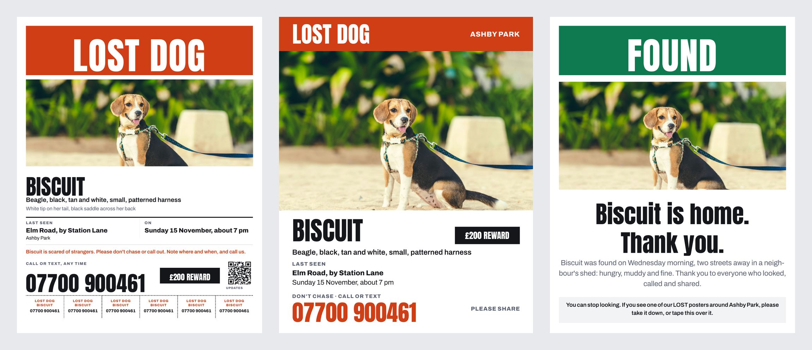
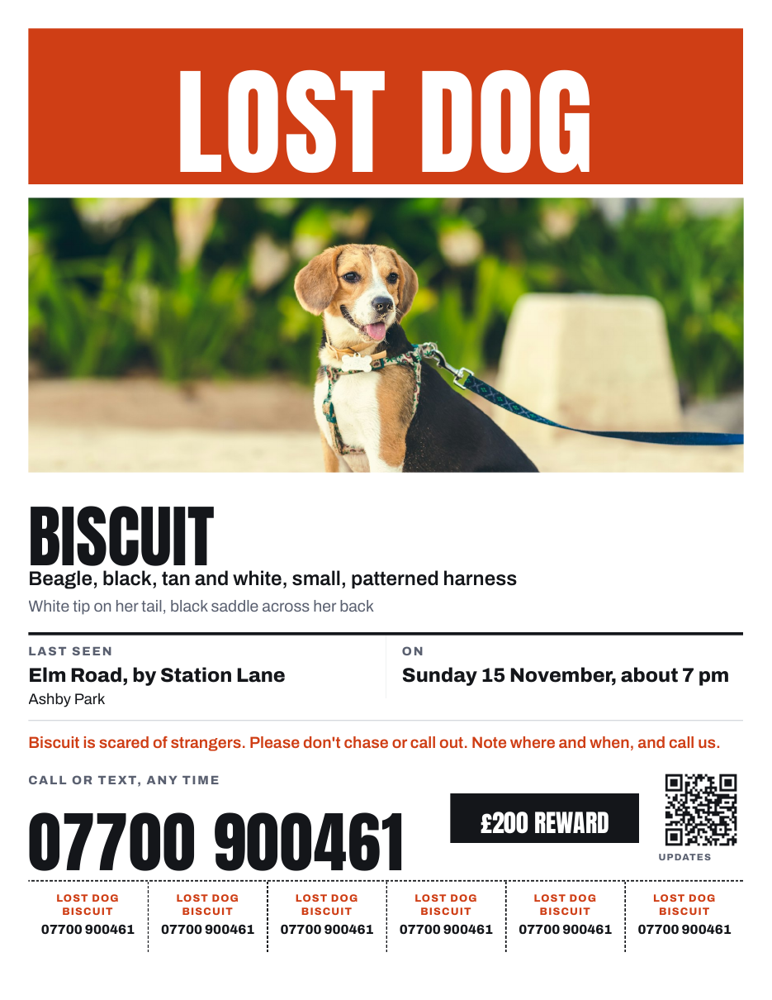
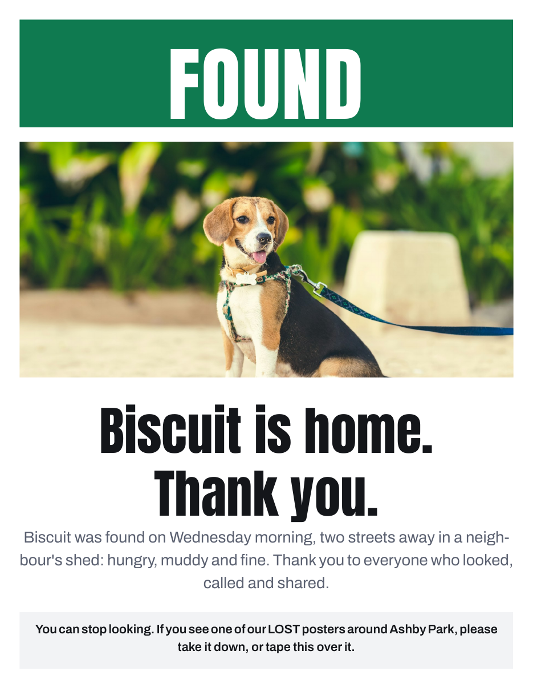
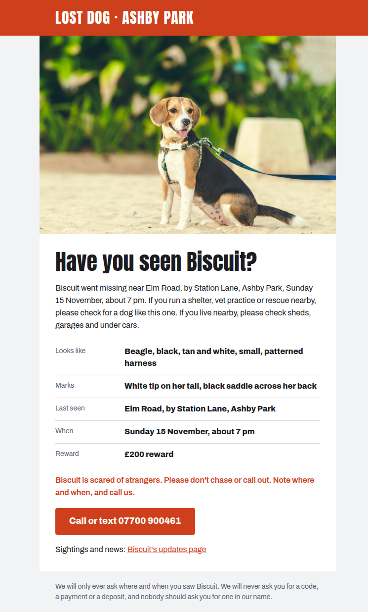
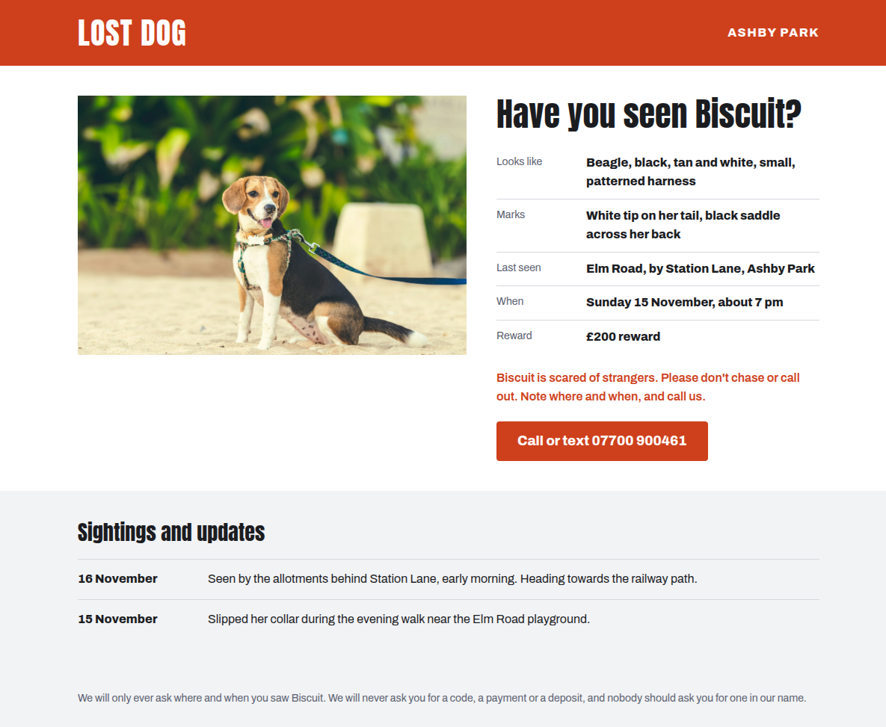

# Homeward

**When a pet goes missing, fill in one file. You get the whole appeal: a big poster with tear-off phone tabs, a card
for local groups, an email for shelters and vets, and an updates page. When your pet comes home, change one word and
every piece turns into a thank-you.**

Built with [Hyper Elements](https://github.com/hyper-elements/hyper-elements) for the Hyper Elements Template Challenge.



## Why this exists

PawBoost alone lists **2,000+ lost and found pets a day** ([pawboost.com](https://www.pawboost.com/), Nov 2026). The
people making these posters are scared and in a hurry, and the posters usually go wrong in the same ways:

- **Too small to read.** "I see lots of missing animal signs but usually can't make out much or most of the
  information on the sign (including the actual picture and name of the animal)… Don't just print out a missing sign on
  regular printer size paper." ([r/YouShouldKnow, 803 upvotes](https://www.reddit.com/r/YouShouldKnow/comments/up7ibl/))
- **Too much private detail.** Guides say to leave your home address and the microchip number off public notices,
  and to spell the month out so nobody mixes up 11/15 and 15/11
  ([missingpets.co](https://missingpets.co/blog/lost-pet-poster), Nov 2026).
- **Scams.** Fake finders ask owners for a "verification code" to "prove you're the owner"
  ([FTC consumer alert](https://consumer.ftc.gov/consumer-alerts/2021/10/google-voice-scam-how-verification-code-scam-works-how-avoid-it)).
- **Nobody hears the ending.** "Don't forget to take the signs down and send found emails out when you find your
  pet!" / "It's stressful walking past a sign for months as it tatters, wondering whatever happened to the pet."
  (same Reddit thread)

Homeward builds each of those lessons into the templates, so the appeal comes out right even on the worst day.

## What it makes

From `pet.json` and one photo, `npm run appeal` writes to `out/appeal/`:

| File | What | For |
|---|---|---|
| `poster.tabloid.pdf` | 11 × 17 in poster, readable from across the road, 7 tear-off phone tabs, QR code to the updates page | lamp posts, noticeboards |
| `poster.letter.pdf`, `poster.a4.pdf` | the same on home-printer paper, 6 tabs | shop windows, vet waiting rooms |
| `card.post.png` | 1080 × 1350 card with the phone number in the picture | Facebook groups, Nextdoor, WhatsApp |
| `email.html` + `email.txt` | "Have you seen Biscuit?" with a details table and a call button | shelters, vet practices, rescues, neighbours |
| `page.html` | the updates page with every sighting, newest first | the link the QR code opens |

Set `"status": "found"` and run it again: the posters become a green **FOUND** notice to tape over the old ones, the card
says **HOME SAFE**, the email tells everyone they can stop looking, and the page keeps the story.

| Lost | Found |
|---|---|
|  |  |
|  |  |

## How Hyper Elements is used

Hyper Elements does the whole job here, not just the drawing. The four outputs are **templates**
(`@hyper-elements/react/template`), and the CLI is the engine that runs them.

- **One root per output.** `<Document>` for the poster (rendered to PDF), `<Canvas>` for the card (PNG), `<Email>` for
  the appeal email, `<Page>` for the updates page.
- **Formats.** The poster template has three `formats` (`tabloid`, `letter`, `a4`) with their own layout sizes, so one
  values file gives three PDFs.
- **Fields with rules.** All four templates share one set of typed fields (`templates/_shared/pet.tsx`). Real advice
  becomes a check that fails the build:
  - `lastSeenArea` has `pattern: "^[^0-9]"`, so a house number is refused: a poster can't print your address.
  - `phone` must look like a phone number. `lastSeenDate` is a real date, written with the month spelled out.
  - `photo` is a `field.image` with `fit: "cover"`, `maxCrop: 0.55` and `minWidth: 900`. If the photo shape would
    crop away too much of your pet, the build stops and says so (`template/asset-cropped`).
- **Rules over the result.** The card requires `image/overflow` and `image/fit`. Nothing may run past the image, and
  the name, the reward and the phone use `fit` to shrink until they fit on one line. The email and the page require
  lint's `contrast`, `link-text` and `lang` checks. The contrast check is why the orange is `#CF3E15` and not a
  brighter one that only reached 3.98:1.
- **Values files and the CLI.** `scripts/appeal.mjs` runs `hyper-elements design new` once per template, which turns
  `pet.json` into checked values files in `appeal/`, then runs `hyper-elements render appeal/`. Fonts and the photo are
  loaded by the CLI and handed to `renderPdf()` and `renderImage()`.
- **A theme.** `defineTheme()` sets the email's and the page's colours, fonts and heading scale once. Its `primary`
  colour follows the status: orange when lost, green when found.
- **`Svg` + `Path`.** The QR code is drawn as one vector path, so it stays sharp on an 11 × 17 print.
- **Email client checks.** `@hyper-elements/email-clients` runs on every email render, and `npm run preview:email`
  writes the email as Outlook, Gmail and Apple Mail show it.

## Run it

Needs Node 20+.

```bash
npm install
npm run appeal                        # the sample dog -> out/appeal/
node scripts/appeal.mjs sample/found.json   # the same dog, home safe
npm run check                         # check all four templates with their example
npm run preview:email                 # out/clients/…: the email in Outlook, Gmail, Apple Mail
```

## Use it for your own pet

1. Put your pet's photo in the folder (a JPEG or PNG, at least 900 px wide, the whole animal).
2. Edit `pet.json`:

```json
{
  "photo": "my-dog.jpg",
  "photoUrl": "https://… (optional: the photo online, so email apps can show it)",
  "status": "lost",
  "kind": "dog",
  "name": "Biscuit",
  "description": "Beagle, black, tan and white, small, patterned harness",
  "markings": "White tip on her tail, black saddle across her back",
  "approach": "shy",
  "lastSeenArea": "Elm Road, by Station Lane",
  "town": "Ashby Park",
  "lastSeenDate": "2026-11-15",
  "lastSeenTime": "about 7 pm",
  "phone": "07700 900461",
  "reward": "£200 reward",
  "updatesUrl": "https://… (where you'll host page.html)",
  "locale": "en-GB",
  "updates": [{ "date": "2026-11-16", "note": "Seen by the allotments behind Station Lane." }]
}
```

3. `npm run appeal`. Print the tabloid poster at a print shop, post the card, send the email to every shelter and vet
   near you, and put `page.html` online (GitHub Pages works) at your `updatesUrl`.
4. Add each sighting to `updates` and run it again. When your pet is home, set `"status": "found"`, add `foundDate`
   and a `foundNote`, and run it once more.

If a value breaks a rule, nothing is written, and the CLI tells you which field and why.

## Project layout

```
pet.json                  your pet (the sample: Biscuit)
templates/_shared/pet.tsx the shared fields, look, QR code and theme
templates/poster.tsx      Document → 3 PDFs
templates/card.tsx        Canvas → PNG
templates/email.tsx       Email → HTML + text
templates/page.tsx        Page → HTML
scripts/appeal.mjs        pet.json → appeal/*.values.json → out/appeal/
fonts/                    Anton + Archivo (SIL Open Font License)
sample/                   the sample photo and a found.json
```

## Sample data

Biscuit is not a real lost dog. The phone number is from Ofcom's range kept for TV and radio drama
(07700 900000–900999, [ofcom.org.uk](https://www.ofcom.org.uk/phones-and-broadband/phone-numbers/numbers-for-drama)),
so it reaches nobody. Ashby Park and its streets are made up. The photo is from Unsplash (credit in `sample/CREDIT.md`).

## License

MIT for the code. Fonts: Anton and Archivo, SIL Open Font License 1.1 (`fonts/OFL-*.txt`).
